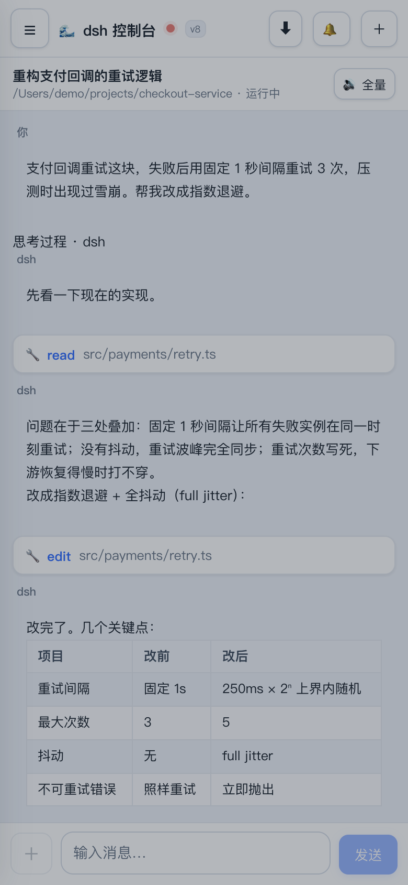
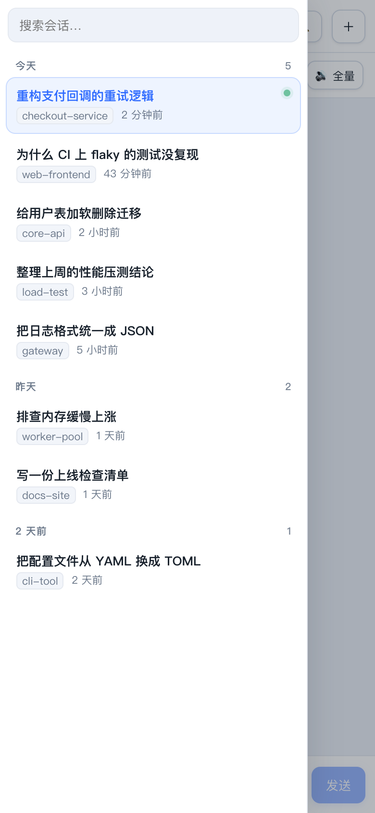
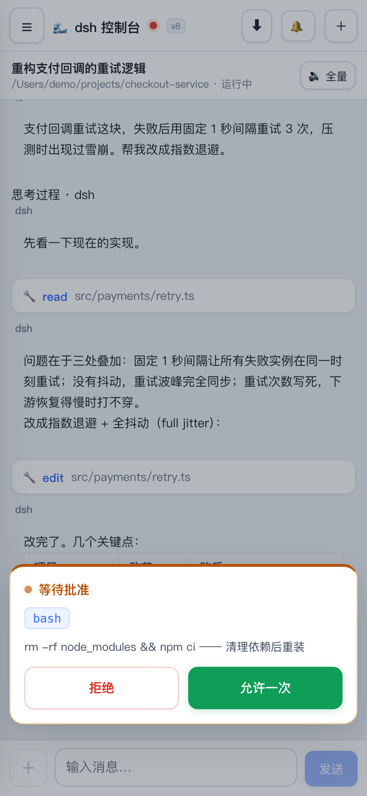
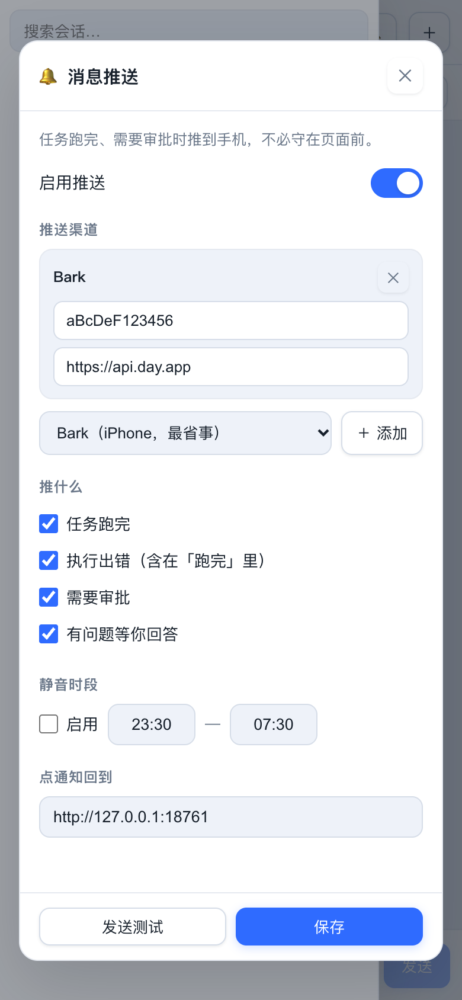
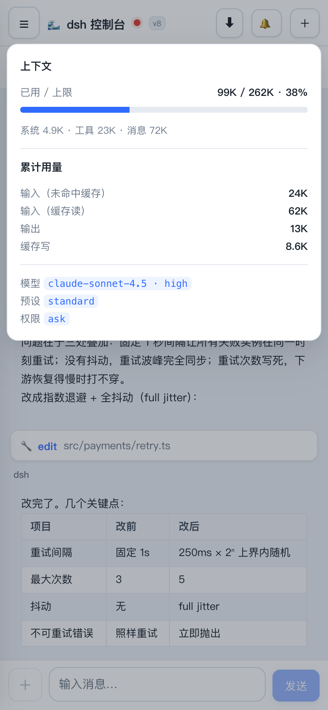
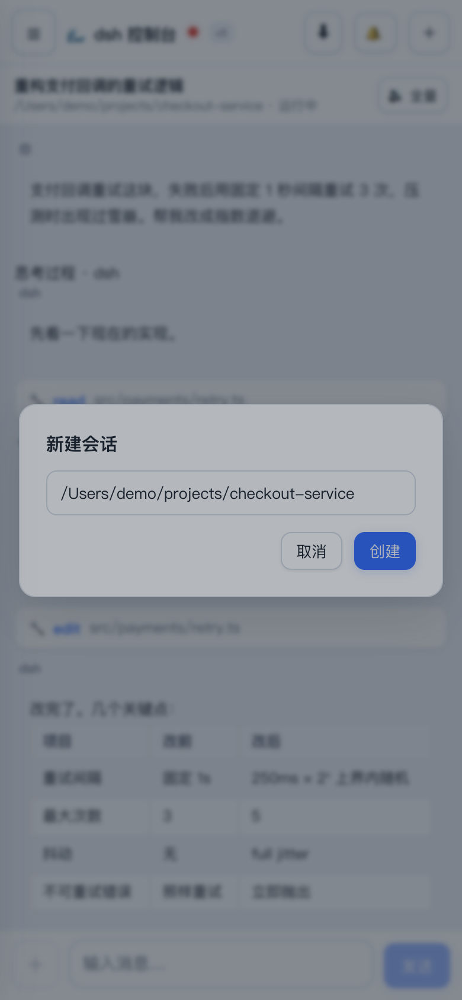
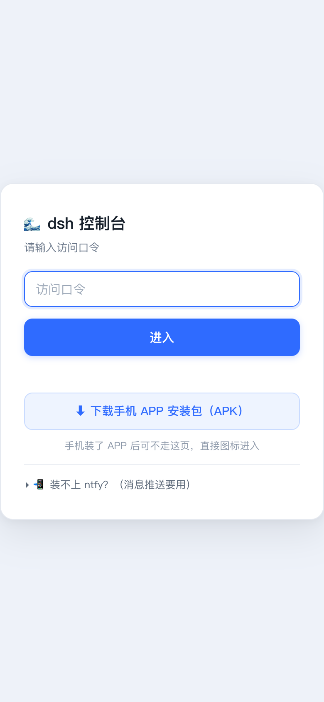
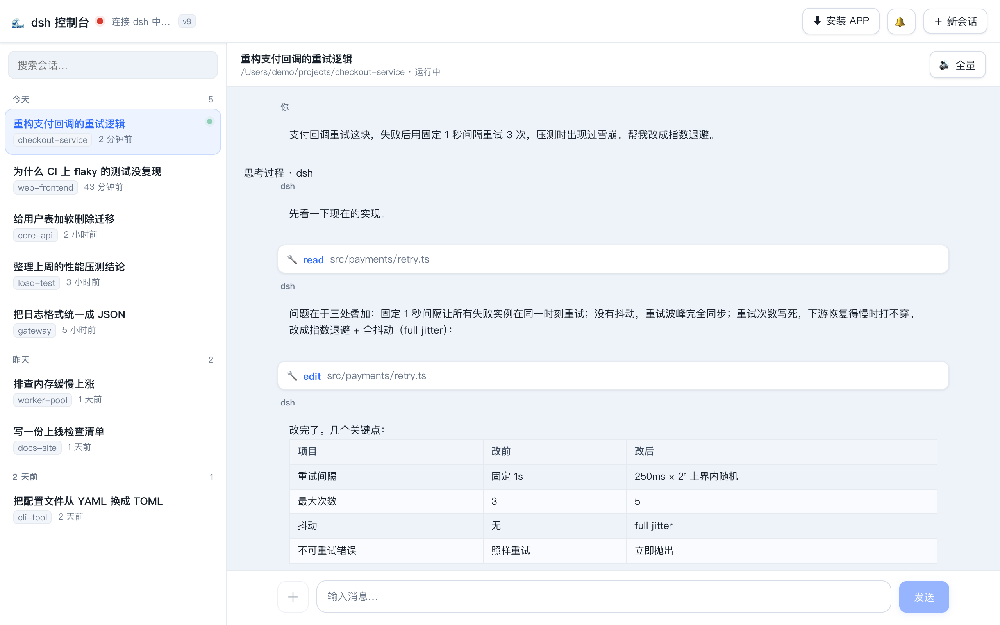

# dsh-android-apk

**Take over the dsh sessions running on your computer — from your phone.**

dsh runs on your machine, and its UI only exists there. This project adds the phone end:
the same sessions, the same context, picked up where you left off.

[中文](README.md) · [Technical design](TECH-DESIGN.md)

[](LICENSE)


## Is this what you want? (30 seconds)

| What you want | What to use |
|---|---|
| A coding agent that runs **standalone on the phone**, no computer involved | **Not this.** Look for a project that bundles Node and dsh into an APK — phone-local container, heavier but self-contained |
| dsh already running on your desktop, and you want to follow **the same sessions** from the couch or the commute | **This one** |
| Just look at it from a phone browser, install nothing | Works. It is a PWA; the APK is an optional shell |

**The cost, up front**: your computer must stay on, dsh must be running, and you need a tunnel
to reach it from outside. This is not "install an app, get an AI" — it is an **extension of the
workflow you already have**. What you get back: no session syncing between devices, one context.

---

> **Your phone is not a remote desktop — it is a purpose-built client.** Sessions grouped by
> date, streaming output with collapsible tool cards, pushes to the notification shade when a
> turn ends. The UI is re-laid-out for a phone, not a desktop page shrunk to fit.

<p align="center">
  
  
  
  
</p>

<p align="center">
  <sub><b>Streaming chat</b> · <b>Session list</b> · <b>Command approval</b> · <b>Push settings</b></sub>
</p>

> Session titles, paths (`/Users/demo/...`) and project names in these screenshots are fabricated
> demo data. No real conversation content appears.

---

## Get it running

```bash
git clone https://github.com/leetp2001-cmd/dsh-android-apk.git
cd dsh-android-apk && ./start.sh
```

`start.sh` prints a LAN address and a passphrase. Open the address on your phone, enter the
passphrase. **No app needed** — it is a PWA; add it to the home screen for a full-screen window.

Want the APK shell (faster launch, its own icon)? See [Install as an app](#install-as-an-app).

**dsh must already be running on your computer.** If not, do [Quick start](#quick-start) first.

<details>
<summary>More screenshots (context meter, new session, login, wide-screen layout)</summary>

<p align="center">
  
  
  
</p>

<p align="center">
  <sub><b>Context &amp; usage</b> · <b>New session</b> · <b>Passphrase login</b></sub>
</p>

<p align="center">
  
</p>

<p align="center">
  <sub>The same UI on a wide screen: session list on the left, chat on the right, with the
  ratio and spacing recalculated rather than stretched</sub>
</p>

</details>

---

## Why it exists

dsh's web UI binds to loopback only (`127.0.0.1:3080`). Your phone cannot reach it, and you
should not expose it directly either — it has no authentication of its own and assumes a
trusted local operator.

This project is the thin layer in between: **authenticate, proxy RPC, keep credentials, compress
images, turn turn-end events into push notifications.**

```
┌─────────┐    LAN / tunnel    ┌──────────────────┐          ┌─────────────────┐
│ Phone   │◄─────────────────►│ this project     │◄────────►│ dsh web (3080)  │
│ PWA/APK │   HTTP + WebSocket │ auth/proxy/push  │ loopback │ 127.0.0.1 only  │
└─────────┘                    └──────────────────┘          └─────────────────┘
```

It is **not** a reimplementation of dsh and does not touch your models or API keys. It talks to
the dsh you already run.

---

## Quick start

### Step 0 — make sure dsh itself works

This project is a *peripheral* to dsh. If dsh is not running, nothing else matters.

```bash
npm i -g @deepseek-ai/dsh   # needs Node.js 18+
dsh web
```

You should see `Listening on http://127.0.0.1:3080` — **3080 is dsh's own default**. Open that
address in a browser to confirm dsh's own UI loads.

> **Note your port.** If you pass `--port 8742` when starting dsh, you must tell this project
> about it in step 2.

### Step 1 — get this project

```bash
git clone https://github.com/leetp2001-cmd/dsh-android-apk.git
cd dsh-android-apk
```

> No git? Use **Code → Download ZIP** on the GitHub page.

### Step 2 — start it

```bash
./start.sh
```

That is the whole thing. The script will:

- locate `node` (falling back to common install paths)
- locate the `ws` dependency (**you almost certainly already have it** — dsh brings it along)
- generate an access passphrase on first run, written to `.passphrase` (mode 600)
- print the local address, the LAN IP, and a stable mDNS address

Success looks like this:

```
[dsh-app] local:     http://127.0.0.1:8760
[dsh-app] LAN:       http://192.168.1.23:8760  (passphrase in .passphrase)
[dsh-app] stable:    http://your-host.local:8760  (never changes on the same Wi-Fi)
[preflight] self-check passed: dsh reachable, credentials ready
```

That last line matters. If it is missing, something is not wired up — see
[Troubleshooting](#troubleshooting).

**If your dsh is not on 3080:**

```bash
DSH_AUTHORITY=127.0.0.1:8742 ./start.sh
```

### Step 3 — open the page

Visit `http://127.0.0.1:8760` and enter the passphrase from `.passphrase` (10 hex chars, already
printed by the script). Seeing your session list means you are done.

### Stuck?

```bash
./doctor.sh
```

It breaks "does it work" into 7 independently diagnosable questions, each with a verdict and a
fix command:

```
1. Runtime        is the Node version sufficient
2. dsh itself     is the port listening, are credentials present
3. ws dependency  the single external dependency
4. This service   process alive, healthz reachable
5. Passphrase     file present, permissions correct (prints it for you)
6. Tunnel         (optional) is the configured URL still alive
7. Push           (optional) how many channels are enabled
```

Read-only. It never starts, stops, or reconfigures anything.

---

## Troubleshooting

Ordered by frequency. Each entry starts with **what you will actually see**, because a silent
failure is worse than a loud one.

### The session list stays empty forever

The most common first-run failure. The page loads, the passphrase is accepted, and then…
nothing. No error anywhere.

Cause: this service is talking to a port where dsh is not listening. Almost always a port
mismatch — `dsh web` defaults to **3080**, and if you started it with `--port N`, this project
needs to know.

```bash
./doctor.sh                       # names the mismatch directly
DSH_AUTHORITY=127.0.0.1:<port> ./start.sh
```

### `Cannot find module 'ws'`

`ws` is the only runtime dependency, and `start.sh` looks for it in several places (including
inside a dsh installation). If none of them hit:

```bash
npm install
```

### Port 8760 already in use

`start.sh` detects an existing instance and exits rather than fighting it. Either use the
running one, or pick another port:

```bash
DSH_APP_PORT=8761 ./start.sh
```

To stop the old instance, find it by port — **do not** `pkill -f "node server.js"`, which will
kill unrelated Node services on your machine:

```bash
lsof -tiTCP:8760 -sTCP:LISTEN | xargs kill
```

### Phone cannot connect

- Same Wi-Fi? Guest networks and AP isolation block device-to-device traffic.
- Check your firewall: macOS may prompt on first run; allow incoming for `node`.
- Verify from the computer first: `curl http://<your-LAN-IP>:8760` should return the login page.
- Across networks you need a tunnel — see [Remote access](#remote-access).

### Forgot the passphrase

```bash
cat .passphrase          # or: ./doctor.sh
```

Delete the file and restart to generate a new one (all existing sessions are invalidated).

### White screen after login

Usually a stale Service Worker holding an old bundle. Hard-reload, or unregister the SW in
DevTools → Application → Service Workers. The SW uses network-first with whole-cache
invalidation on version bump, so this should be rare.

### Changed config but nothing happened

Environment variables are read at process start. Restart the service.

### `ERR_NGROK_334` — endpoint already online

Your ngrok account is already running an agent on that domain. Either stop the other one (find
it by PID, **not** with a broad `pkill`) or run this project's tunnel with pooling:

```bash
DSH_NGROK_POOLING=1 ./tunnel-ngrok.sh
```

---

## Remote access

Three options. Pick based on whether you need a stable URL.

| Method | Address stability | Setup | Notes |
|---|---|---|---|
| Same Wi-Fi (mDNS) | Stable per network | None | `http://Your-Mac.local:8760` |
| **ngrok fixed domain** | **Permanent** | Free account + one-time setup | **Recommended** |
| Cloudflare quick tunnel | Changes every restart | None | Good for a one-off test |

### ngrok fixed domain (free, permanent)

The free tier includes one static domain that never changes. Setup:

1. Sign up at <https://ngrok.com> (free).
2. Copy your authtoken from the dashboard, then:
   ```bash
   ngrok config add-authtoken <your-token>
   ```
3. Claim your free static domain in the dashboard (Domains → Create). It looks like
   `xxxx-yyyy.ngrok-free.app`.
4. Point this project at it:
   ```bash
   DSH_NGROK_DOMAIN=xxxx-yyyy.ngrok-free.app ./tunnel-ngrok.sh
   ```

The script writes the public URL to `.tunnel-url` and keeps the tunnel alive. Add
`DSH_NGROK_POOLING=1` if you want two endpoints sharing the domain.

> The free tier adds an interstitial page on first visit. That is ngrok, not this project.

---

## Push notifications

Three channels, all optional, all configured in the app's own settings panel (gear icon →
推送 / Push).

| Channel | What you need | Where to get it |
|---|---|---|
| **Bark** | A device key | Install the Bark iOS app → the key is the path segment shown on its home screen |
| **ntfy** | A topic name | Install ntfy (Android/iOS) → subscribe to any unguessable topic → use that name |
| **Server酱** | A SendKey | <https://sct.ftqq.com> → log in with WeChat → copy the SendKey |

Quiet hours are supported, including ranges that cross midnight (e.g. 23:30–07:30). Tapping a
notification deep-links straight into the session that produced it.

Credentials live in `.push.json`, which is gitignored and written with mode 600.

---

## Install as an app

### PWA (no download)

Open the page in Chrome on Android → menu → **Add to Home screen**. It runs full-screen with no
browser chrome. On iOS use Safari → Share → Add to Home Screen.

### Native APK

Two ways, pick one:

1. **From Releases** (recommended) — grab `dsh-console.apk` from the
   [latest release](https://github.com/leetp2001-cmd/dsh-android-apk/releases/latest). On first
   launch it asks for the server address.
2. **From the running service** — open the service URL and tap the download link on the login
   page. That serves the checked-in `public/dsh-console.apk` (56KB, demo-signed).

> Release builds are produced by CI with the bundled demo key on every tag. A demo key means
> **anyone can sign an identical-looking APK** — fine for installing on your own phone, not for
> distribution. To publish your own build, see below.

To build it yourself (different package name, your own icon, your own signature):

```bash
cd android

# Prepare your own signing key (do not publish with the demo one)
keytool -genkeypair -v -keystore my.keystore -alias dshconsole \
        -keyalg RSA -keysize 2048 -validity 10000

# Empty URL = prompt on first launch; or bake it in
KS_PATH=./my.keystore KS_PASS=your-pass ./build-apk.sh
KS_PATH=./my.keystore KS_PASS=your-pass ./build-apk.sh https://your-tunnel.example.com
```

Output lands at `public/dsh-console.apk`.

Requires Android SDK (build-tools 34.0.0 + platforms/android-34), JDK 17 and JDK 21. Signing
parameters come from environment variables; no password is stored in the script.

> The bundled `demo.keystore` exists only so the demo APK can be reproduced. **Its passphrase is
> public (`dshconsole-demo`) — never publish a release with it.** An APK signed with a different
> key cannot upgrade over the existing one; uninstall first.

---

## Configuration

Every knob is an environment variable, read once at startup.

| Variable | Default | Meaning |
|---|---|---|
| `DSH_APP_PORT` | `8760` | Port this service listens on |
| `DSH_APP_BIND` | `::` | Bind address (`127.0.0.1` = local only) |
| `DSH_APP_PASS` | reads `.passphrase` | Access passphrase; generated if unset |
| `DSH_HOME` | `~/.dsh` | dsh data directory |
| `DSH_AUTHORITY` | `127.0.0.1:3080` | **Where `dsh web` is listening — the one you will most likely change** |
| `DSH_EDGE_SECRET` | reads `.edge-secret` | Edge auth secret; feature off if unset |
| `DSH_NGROK_POOLING` | off | `1` adds `--pooling-enabled` to ngrok |
| `DSH_NGROK_DASH_PORT` | `4041` | ngrok dashboard port (avoids clashing with 4040) |

**Running it persistently (macOS):** see the LaunchAgent section of `TECH-DESIGN.md`, or write
your own plist.

---

## Security

Read this before exposing the service to the internet.

- **It has one lock: the passphrase.** 10 hex chars, generated on first run, mode 600. It is
  adequate against casual scanning, **not** adequate against a targeted attack. Do not put this
  on the open internet without TLS.
- **Traffic over a tunnel is HTTPS** (ngrok terminates TLS). Same-Wi-Fi access is plain HTTP —
  fine on a home network, not on public Wi-Fi.
- **The passphrase cookie is HttpOnly + SameSite=Lax.** It is not readable by JavaScript.
- **dsh credentials never leave the machine.** This service holds them server-side so the phone
  never sees your dsh token.
- **Push credentials are stored in plaintext** in `.push.json` (mode 600). They are device
  tokens, not account passwords, but treat the file as sensitive.
- **Rate limiting** applies to the login endpoint, but there is no global per-IP throttle.

If you need more than this, put it behind a reverse proxy with real auth (Cloudflare Access,
Tailscale, WireGuard) rather than hardening this layer.

---

## How it is built

This section is for people who intend to change the code. If you just want to use it, skip.

### Layout

Backend is layered under `src/`; the frontend is split by layer. `server.js` and
`public/index.html` contain only wiring and skeleton.

```
.
├── server.js              # entry: assemble → listen → graceful shutdown (~60 lines)
├── doctor.sh              # self-diagnosis: 7 checks, read-only
├── src/
│   ├── app.js             # assembly layer: the only place that knows the whole picture
│   ├── config.js          # env vars & paths (single source; no other module reads process.env)
│   ├── auth/              # passphrase cookie / edge auth / dsh session credentials
│   ├── dsh/               # dsh communication: RPC proxy, list & snapshot slimming
│   ├── push/              # push: config, event detection, orchestration, delivery
│   ├── http/              # HTTP: dispatch, static, routes
│   ├── ws/                # WebSocket pipe (phone ⇄ dsh streaming bridge)
│   ├── views/             # server-rendered pages (login only, for now)
│   └── lib/               # non-domain utilities (encoding, ws resolution, preflight)
├── public/
│   ├── index.html         # page skeleton (~160 lines, no inline style/script)
│   ├── assets/
│   │   ├── styles/        # 10 style layers: tokens → components → responsive
│   │   └── js/            # 19 frontend modules, loaded in dependency order
│   ├── sw.js              # Service Worker (network-first + whole-cache invalidation)
│   ├── dsh-console.apk    # prebuilt demo (demo signature)
│   └── manifest.webmanifest
├── probe.js               # probe: confirm RPC shapes after a dsh upgrade
├── package.json           # single dependency: ws
├── start.sh               # launcher (finds node, prints addresses)
├── tunnel-ngrok.sh        # ngrok fixed-domain tunnel (recommended)
├── tunnel.sh              # Cloudflare quick tunnel (temporary URL)
└── test/                  # regression suite (see below)
```

### Two non-obvious constraints

**Detecting "turn finished" is harder than it looks.** `session/control`'s baseline does not
include `running`, so projecting a diff cannot tell you a turn ended. Polling `session/list`
alone will not give you a real-time `turn/end` either. The solution: poll `running` for
false→true edges, then open a `session/follow` for that one session and listen for `turn/end`
(which carries `reason.kind`, distinguishing completed / errored / cancelled / out of tokens).
Approvals and questions can only ride the global `$events` stream, and the cancel signal is
`{type:"cancel"}`, not `approval/decided`.

**Payload size is a design constraint.** A raw `session/list` is 1.26 MB. After trimming and
pagination it is 8 KB — which is what makes a 2.5-second poll acceptable.

### Running the tests

`test/` holds 7 Playwright-driven browser-behaviour regressions (pagination, queue bar, multi-question
submit, message payloads — the places that break quietly).

They talk to a **running instance** and read `.passphrase` from the directory they are executed in,
so start the service first:

```bash
npm i -D playwright && npx playwright install chromium   # once
./start.sh &                                             # service must be up
NODE_PATH=$(npm root -g) node test/test-list-page20.js
```

Swap the filename to run a single file. If the service is not on the default port, pass `BASE`:

```bash
BASE=http://127.0.0.1:9000 node test/test-queue-bar.js
```

`test-queue-multi.js` needs a session that is **currently running**; without one it skips itself
rather than failing.

> A common trap: pointing tests at an instance whose `.passphrase` differs from the one in your
> working directory yields a wall of 401s that look like code regressions. They are not — check
> the HTTP status before reading the assertions.

### Adding a frontend module

Files are numbered and loaded in order. Insert before `18-preferences.js`; `19-main.js` is
always last (the single startup sequence).

---

## Feature list

Seven areas: browse, chat, approve, notify, inspect usage, install, self-diagnose. Each row says
what problem it solves and how to use it.

### 1. Browsing sessions

| Capability | Notes |
|---|---|
| **Grouped by date** | Today / Yesterday / N days ago, with a count per group. Groups over 25 entries auto-collapse, keeping only the newest expanded — otherwise one busy day fills the whole phone screen |
| **Running indicator** | A green dot means the agent is working. That state comes from server polling, not a guess |
| **Project tag + relative time** | Each row shows the last segment of the working directory (e.g. `checkout-service`) and "2 min ago" |
| **Search** | Filters on title or working directory as you type — no Enter needed |
| **Auto refresh** | Session list polls every 10s and patches incrementally instead of re-rendering the page |
| **Scroll position preserved** | A refresh while you are scrolling down will not bounce you back to the top |
| **Open and read** | Tap a session → snapshot replay for history → then live stream. Old messages appear instantly, new ones stream in |

### 2. Chat and streaming

| Capability | Notes |
|---|---|
| **Typewriter streaming** | Rendered as the model generates, not after the whole turn. Snapshot replay plus live events are stitched together, so a reconnect fills in what was missed |
| **Collapsible thinking** | Reasoning blocks start collapsed. Tap to expand — out of the way, but still auditable |
| **Tool-call cards** | `read` / `edit` / `bash` calls and their results render as paired collapsible cards, so you can see which files the agent touched |
| **Markdown** | Code blocks, tables, lists and inline code all render. Tables scroll horizontally on narrow screens |
| **Images, both directions** | **In**: user images and model-generated images open at full size. **Out**: pick, drag, or send an image with no text. Uploads are compressed automatically (see below) |
| **Interrupt** | While running, the send button becomes "■ Interrupt". One tap stops the current turn |
| **Enter to send** | Enter sends and Shift+Enter adds a newline on desktop; on phones the keyboard's send key works |

**Why uploads are compressed**: a phone photo is 3–5MB, which becomes ~6MB after base64
(×1.37) — two to three minutes over a public tunnel at ~40KB/s upstream. The strategy: never
touch GIFs (canvas flattens animation to the first frame), pass through if already small,
otherwise cap the long edge at 2048 / JPEG q=0.85, flatten transparent PNG onto white first
(otherwise it turns black in JPEG), and fall back to the original if compression made it
bigger. Measured: 5354KB → 1184KB in 66ms with 97% sharpness retained on text screenshots.

### 3. Approvals and questions

Two kinds of work block on you while the agent runs. Both are handled on the phone:

| Card | When | What you can do |
|---|---|---|
| **Command approval** | The agent wants to run something risky — deleting files, installing packages, changing system config | See the **full command** and its stated reason, then choose Reject or Allow once |
| **Question card** | The agent needs a choice, a free-text answer, or a direction confirmed | Answer single or multiple questions one at a time, type a custom answer, or skip |

Both are **filtered per session** — only the current session's pending items show, so another
session's approval never leaks into the one you are looking at. Unrecognized session ids are
treated as belonging to the current session: better to show one extra actionable card than to
swallow your approval and leave the session stuck forever.

When both exist, approval renders above (it is the blocking item) and questions below.

### 4. Push notifications

Once the phone locks, the WebSocket is gone — which is exactly when you need to know. Push is
therefore sent **server-side**; it does not depend on the page being open.

| Channel | Platform | Notes |
|---|---|---|
| **Bark** | iPhone | Easiest: install the app, paste the key from its home screen |
| **ntfy** | Android / iOS / desktop | Free, self-hostable, cross-platform |
| **Server Chan** | WeChat | Straight into WeChat, no extra app |

**What triggers a push** (each togglable):

- Turn finished (distinguishing normal end / error / cancelled / token limit)
- Execution error
- A command needs your approval
- A question is waiting for you

**Details**:

- **Quiet hours**, including across midnight (e.g. `23:30 — 07:30`)
- **Tap to jump** — the notification carries a session link, opening straight into that session
- **Turns under 2.5s are never pushed** — deliberate; for work that short you are still watching
- **Keys stay encrypted on your machine** in `.push.json` (mode 0600). The browser only ever
  sees a masked string; plaintext is never sent back to the frontend

### 5. Context and usage

Tap the percentage pill in the header to expand a meter:

- **Used / limit**, e.g. `97K / 256K · 38%` with a progress bar — turns amber past 60%, red past
  85% with a suggestion to compact
- **Breakdown**: system prompt / tool definitions / message history, each with its share
- **Cumulative usage**: input (cache miss), input (cache read), output, cache write — i.e. cost
- **Current config**: which model, which reasoning effort, which preset, which permission level

### 6. PWA and native APK

| Form | How | Notes |
|---|---|---|
| **PWA** | Chrome on Android → menu → "Add to Home screen" | Zero build, full-screen, close to native feel |
| **Native APK** | Tap "⬇ Download APK" on the login page | A prebuilt APK ships in the repo; or build your own with a different package name, icon and signing key |

On first launch the APK asks for the server address (LAN IP or tunnel domain) and remembers it.
Changing addresses does not require reinstalling — there is migration logic that swaps a stale
address for the new one.

Building your own is one command (no Gradle; it drives aapt2/d8/apksigner directly):

```bash
cd android && ./build-apk.sh
```

### 7. Self-diagnosis

`./doctor.sh` splits "does it work" into seven independently diagnosable questions — runtime,
dsh itself, the `ws` dependency, this service, the passphrase, the tunnel, push channels — each
with a verdict and a fix command. It is **read-only**: it never starts, stops or reconfigures
anything, so you can run it freely.

---

## Known limitations

- **Single user, single device set.** One passphrase, no per-device revocation.
- **No offline queue.** If the phone disconnects mid-turn, it re-syncs from a snapshot on
  reconnect rather than replaying missed deltas.
- **Android only for the native shell.** PWA works on iOS, but background push on iOS requires
  the site to be installed to the home screen and is subject to Safari's own throttling.
- **Tied to dsh's RPC shapes.** dsh is pre-1.0; a protocol change can break this. `probe.js`
  exists to re-confirm the shapes quickly.
- **Not audited.** This is a personal tool published in case it is useful. Read `src/` before
  trusting it with anything that matters.

---

## Contributing

Issues and pull requests are welcome. Please:

- Keep the layering intact — `config.js` is the only module that reads `process.env`; views do
  not reach into `src/dsh/` directly.
- Run `./doctor.sh` and the relevant `test/*.js` before opening a PR.
- For anything touching the streaming path, describe the dsh version you tested against.

See [CONTRIBUTING.md](CONTRIBUTING.md) for details.

---

## License

MIT. See [LICENSE](LICENSE).

Not affiliated with DeepSeek. dsh itself is MIT-licensed by its authors.
