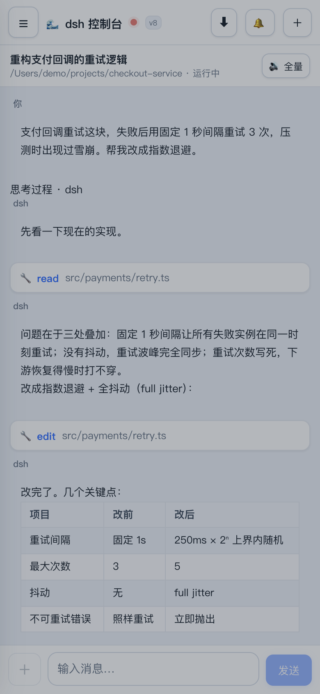
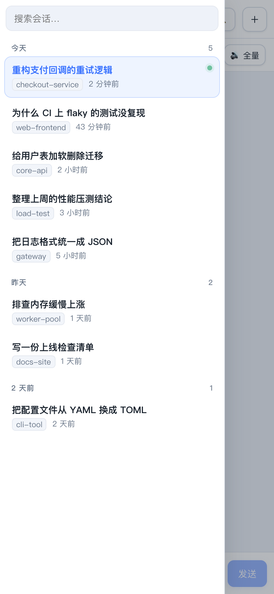
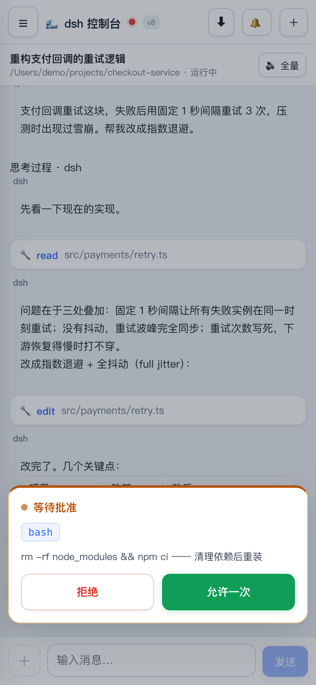
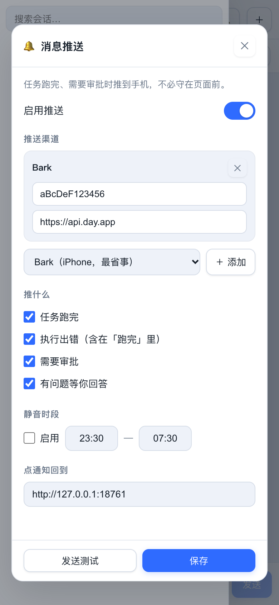
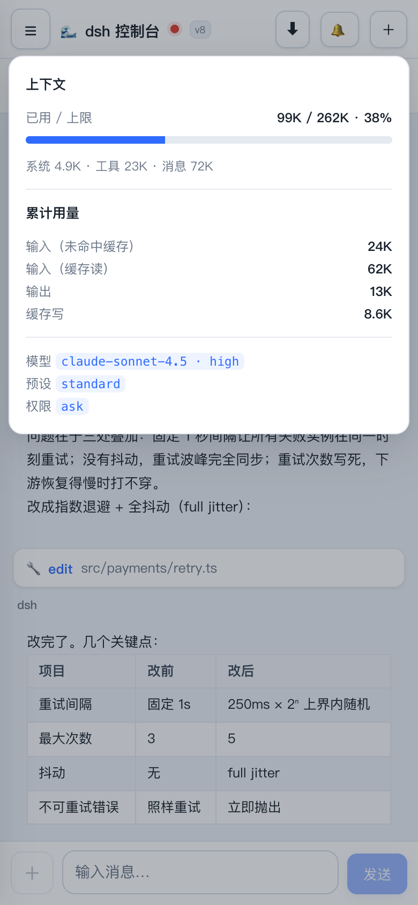
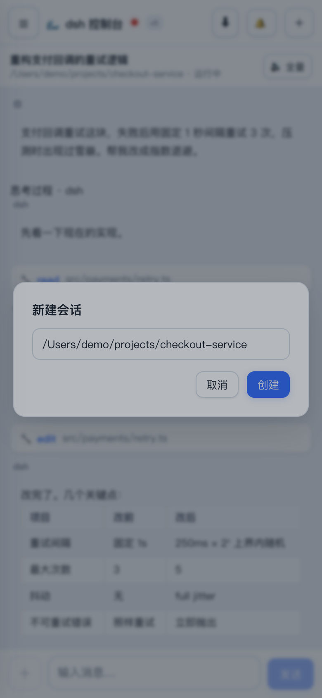
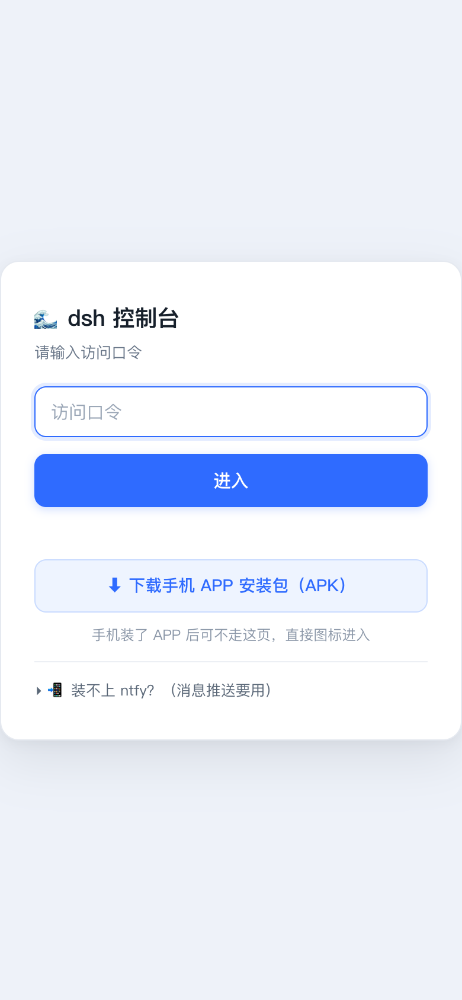
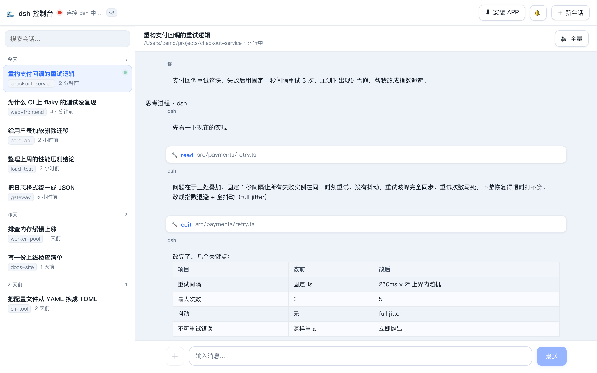

# dsh-android-apk

**把跑在电脑上的 dsh（DeepSeek Harness）装进手机。**

用手机查看会话列表、流式聊天、收发图片，任务跑完或需要审批时收到推送通知。

[English](README.en.md) · [技术设计](TECH-DESIGN.md)

[](LICENSE)


> **手机不是远程桌面，是一个专门的客户端。** 会话列表按日期分组、流式输出带工具卡片、
> 任务跑完推到通知栏 —— 界面是为手机重新排的，不是把桌面版缩小塞进浏览器。

<p align="center">
  
  
  
  
</p>

<p align="center">
  <sub><b>流式聊天</b> · <b>会话列表</b> · <b>命令审批</b> · <b>消息推送</b></sub>
</p>

<p align="center">
  
  
  
</p>

<p align="center">
  <sub><b>上下文与用量</b> · <b>新建会话</b> · <b>口令登录</b></sub>
</p>

<p align="center">
  
</p>

<p align="center">
  <sub>同一份界面在宽屏上自动变成左右分栏：左边会话列表，右边聊天，比例和间距都是重新算的</sub>
</p>

> 截图里的会话、路径（`/Users/demo/...`）和项目名都是构造的演示数据，不含任何真实会话内容。

---

## 目录

- [为什么需要它](#为什么需要它) ← **先看这个，两分钟**
- [5 分钟跑通](#5-分钟跑通)
- [出问题了](#出问题了)
- [手机访问](#手机访问)
- [推送通知](#推送通知)
- [装成 APP](#装成-app)
- [配置项](#配置项)
- [安全须知](#安全须知)
- [它为什么这样设计](#它为什么这样设计)
- [功能清单](#功能清单) ← **想先看能干什么，跳这里**
- [目录结构](#目录结构)
- [已知限制](#已知限制)
- [参与贡献](#参与贡献)

---

## 为什么需要它

dsh 的 web 界面只监听回环地址（`127.0.0.1:3080`），手机访问不到。而直接把它暴露出去
也不合适 —— 它自己没有鉴权，默认假设操作者在可信的本地环境里。

本项目就是补上中间这层：**验证口令、转发 RPC、保管凭据、压缩图片、把回合结束转成推送。**

```
┌─────────┐   局域网 / 隧道    ┌──────────────────┐          ┌─────────────────┐
│ 手机    │◄─────────────────►│ 本项目            │◄────────►│ dsh web (3080)  │
│ PWA/APK │   HTTP + WebSocket │ 鉴权 / 代理 / 推送 │  同机回环 │ 监听 127.0.0.1  │
└─────────┘                    └──────────────────┘          └─────────────────┘
```

它**不是** dsh 的重新实现，也不碰你的模型和 API key。它只跟已经在跑的 dsh 对话。

---

## 5 分钟跑通

### 第 0 步：确认 dsh 本身能用

本项目是 dsh 的**外围**，dsh 没装好一切都白搭。先单独确认它：

```bash
# 还没装？装一个（需要 Node.js 18+）
npm i -g @deepseek-ai/dsh

# 启动 dsh web 界面
dsh web
```

看到 `Listening on http://127.0.0.1:3080` 就对了（默认端口 **3080**）。
浏览器打开这个地址能看到 dsh 自己的界面，说明第 0 步完成。

> **记下你的端口**。如果你启动时加了 `--port 8742` 之类的参数，后面第 2 步要跟着改。

### 第 1 步：拿到本项目

```bash
git clone https://github.com/OWNER/dsh-android-apk.git
cd dsh-android-apk
```

> `OWNER` 是仓库所属账号的占位符。把地址栏里实际的账号名填进去，或者直接在 GitHub
> 页面上点 **Code → Download ZIP** 下载，跳过 clone。

### 第 2 步：启动

```bash
./start.sh
```

就这一条。脚本会自动：

- 找 node（PATH 里没有就翻常见安装位置）
- 找 `ws` 依赖（**绝大多数情况你机器上已经有了** —— 装了 dsh 就顺带装上了）
- 首次运行生成访问口令，写进 `.passphrase`（权限 600）
- 打印本机地址、局域网 IP、mDNS 固定地址

看到这样就算成功：

```
[dsh-app] 本机访问: http://127.0.0.1:8760
[dsh-app] 局域网 IP: http://192.168.1.23:8760  （口令见 .passphrase）
[dsh-app] 固定地址:   http://your-host.local:8760  （同 Wi-Fi 永不变）
[preflight] 自检通过：dsh 可达，凭据就绪
```

最后那行 `自检通过` 很重要 —— 没有它说明有环节没接上，往下看[出问题了](#出问题了)。

**如果你的 dsh 不在 3080：**

```bash
DSH_AUTHORITY=127.0.0.1:8742 ./start.sh
```

具体端口在你上一步 `dsh web` 的输出里，或者 `./doctor.sh` 会直接告诉你。

### 第 3 步：打开页面

浏览器访问 `http://127.0.0.1:8760`，输入 `.passphrase` 里的口令（10 位十六进制，脚本已经打出来了）。

看到会话列表 = **全部搞定**。

### 卡住了？

```bash
./doctor.sh
```

它把「能不能用」拆成 7 个可单独诊断的问题，逐条给结论和修复命令：

```
1. 运行环境        Node 版本够不够
2. dsh 本体        端口在不在听、凭据文件在不在
3. ws 依赖         唯一的外部依赖找没找到
4. 本服务          进程活着没、healthz 通不通
5. 访问口令        文件在不在、权限对不对（会直接把口令打出来）
6. 公网隧道        （可选）配置的地址还通不通
7. 推送            （可选）有没有启用的渠道
```

只读不写，不启停服务、不改配置，随便跑。

---

## 出问题了

按出现频率排序。每条都先给「你会看到什么」，再给原因和修法。

### 页面能打开，但会话列表一直空白

**最常见**。代理起来了但连不上 dsh。检查启动日志里有没有 `[preflight] 自检通过`。

```bash
./doctor.sh          # 直接告诉你哪一环断了
```

九成是端口不对：dsh 默认 **3080**，如果你改过就必须同步：

```bash
DSH_AUTHORITY=127.0.0.1:<你的端口> ./start.sh
```

错误信息现在会写清楚，比如：

```
连不上 dsh（http://127.0.0.1:3080 拒绝连接）。
请确认 dsh web 已启动：另开一个终端执行 "dsh web"……
```

### 启动就报「找不到 ws」

唯一的外部依赖。任选一种：

```bash
npm install          # 仓库目录装一份（推荐）
npm i -g ws          # 或全局装
```

通常不用管：装了 dsh 的话它一定在，脚本会自动找到。

### 端口 8760 被占用

```bash
DSH_APP_PORT=8761 ./start.sh    # 换端口，最简单
```

或者停掉占着它的那个实例 —— **先看清楚再杀**，不要用 `pkill -f node`，
那会把你机器上别的 node 服务一起带走：

```bash
lsof -nP -iTCP:8760 -sTCP:LISTEN     # 看 PID 是谁
kill <PID>
```

### 手机连不上电脑

按顺序排查：

1. **同一个 Wi-Fi 吗？** 手机在蜂窝网络必须走隧道（见[手机访问](#手机访问)）
2. **绑定地址对不对？** `./start.sh` 默认绑 `::`（双栈）。如果你为了安全设过 `DSH_APP_BIND=127.0.0.1`，那就只有本机能连，改回来：
   ```bash
   DSH_APP_BIND=:: ./start.sh
   ```
3. **电脑防火墙拦了吗？** macOS「系统设置 → 网络 → 防火墙」，允许 node 接收入站连接
4. **用固定地址试**：`http://你的主机名.local:8760`，比 IP 可靠（IP 会随 DHCP 变）

### 忘记口令了

```bash
cat .passphrase                       # 直接看
DSH_APP_PASS=新口令 ./start.sh         # 或指定一个新的
rm .passphrase && ./start.sh          # 或删掉让它重新生成
```

### 页面白屏 / 样式错乱

前端文件缓存了旧的。手机上：

- 点顶栏的版本号徽标（强制重新拉取前端）
- 或浏览器里清一下该站点数据
- Service Worker 缓存已按版本号整体作废，升级后一般会自动刷新

### 改了配置没生效

`./start.sh` 发现端口已有实例就直接退出（打印「端口已有实例在跑」）。先停旧实例再起：

```bash
# 按端口找，只杀这一个，不碰别的 node 进程
kill $(lsof -nP -iTCP:8760 -sTCP:LISTEN -t) && ./start.sh
```

**别用 `pkill -f "node server.js"`** —— 你机器上可能还有别的项目在用同名入口，
会一起被带走。

### 通配符：`ERR_NGROK_334`

见[ngrok 那节](#会踩的坑err_ngrok_334)。

---

## 手机访问

### 同一 Wi-Fi（最简单）

手机浏览器打开 `./start.sh` 打印的**局域网 IP** 或 **`.local` 固定地址**，输入口令。

`.local` 那个更值得存 —— IP 会随路由器 DHCP 变化，`.local` 不会。

### 出门在外（4G / 别处 Wi-Fi）

需要一个公网隧道：

| 方式 | 命令 | 地址固定？ | 需要什么 |
|---|---|---|---|
| **ngrok 免费** | `./tunnel-ngrok.sh` | ✅ **永久不变** | 注册免费账号（5 分钟） |
| Cloudflare 快速 | `./tunnel.sh` | ❌ 每次重启都变 | 装 `cloudflared` |
| Cloudflare 命名 | `./tunnel-setup.sh your.domain` | ✅ 固定 | 自有域名 + CF 托管 |
| 自有反代 | 自行配置 | ✅ | 一台公网服务器 |

#### 推荐：ngrok 免费固定域名

这是**唯一一个「零成本 + 域名永久固定」**的组合。域名跟账号绑定，重启电脑、换 Wi-Fi 都不变，手机里存一次就不用再改。

**第 1 步 · 注册**
打开 <https://dashboard.ngrok.com/signup>，邮箱或 Google/GitHub 账号注册。

**第 2 步 · 复制 authtoken**
登录后进 <https://dashboard.ngrok.com/get-started/your-authtoken>，
标着 "Your Authtoken" 的那串（形如 `2abc...XYZ`）就是。

**第 3 步 · 装上并写入 token**

```bash
# macOS
brew install ngrok/ngrok/ngrok
# Linux：https://ngrok.com/download 下载解压后放进 PATH

ngrok config add-authtoken 粘贴你的token
```

token 存在 `~/.config/ngrok/ngrok.yml`，不在本仓库里。

**第 4 步 · 查你的固定域名**
进 <https://dashboard.ngrok.com/domains>，形如 `xxxx-xx-xx-xx-xx.ngrok-free.dev`
（或 `.ngrok-free.app`）的那条就是你的 **dev domain**。

这个域名属于你的账号，**永久不变**，但：

- 免费版**只能有这一个**，名字是随机分配的，**不能改名**
- 不能换成自己的域名（要自有域名得付费）

**第 5 步 · 启动**

```bash
./start.sh &          # 先起本服务
./tunnel-ngrok.sh     # 再起隧道
```

脚本会把端点挂到你的 dev domain，打印公网地址并写入 `.tunnel-url`。

```bash
./tunnel-ngrok.sh stop     # 停止
./tunnel-ngrok.sh check    # 校验地址是否真的通到本机
./tunnel-ngrok.sh status   # 看 token / 域名 / 进程状态
```

**免费版额度**（够个人用）：

| 项目 | 额度 |
|---|---|
| 流量 | 1 GB / 月 |
| HTTP 请求 | 20,000 / 月 |
| 在线端点 | 3 个 |
| 域名 | 1 个 dev domain |

超出会暂停到下一计费周期。日常看会话、发消息能用很久，但**别用它传大图或长期刷**。

**那个"提示页"**：免费版会给浏览器插一个 ngrok 防钓鱼提示页，点一次 Visit 后 7 天不再出现。
APP 端已自动带 `ngrok-skip-browser-warning` 头，走 APP 看不到。

##### 会踩的坑：`ERR_NGROK_334`

免费版一个账号只有一个 dev domain，**同一域名同时只能有一个在线端点**。
如果你机器上已经有一个 ngrok 在跑（比如 dsh 自己的启动脚本拉起的），再跑一次就撞这个错。

脚本会先探测 4040/4041 面板：**发现已有隧道在转发本端口就直接复用并打印地址**，不会去抢。

真要同时跑两个端点，两边都得加 `--pooling-enabled`（只加一边无效）：

```bash
DSH_NGROK_POOLING=1 ./tunnel-ngrok.sh
```

#### 其他方式

⚠️ `tunnel.sh`（Cloudflare 快速隧道）会把服务暴露到公网。口令是唯一防线，
**用完记得 `./tunnel.sh stop`**。地址每次重启都变，只适合临时应急。

`tunnel-setup.sh` 还支持边缘认证（`X-DSH-Edge` 头），让走隧道的请求免输口令，
同时因为源站只监听回环 + 头由 CF 覆盖注入，伪造无效。详见 `src/auth/edge.js`。

---

## 推送通知

手机锁屏后 WebSocket 断了 —— 这恰恰是最需要通知的时候。所以推送在服务端做。

### 拿到 key

**Bark（iOS，最简单）**

1. App Store 装 [Bark](https://apps.apple.com/app/bark-customed-notifications/id1403753865)
2. 打开 App，首页会显示一个形如 `https://api.day.app/你的key/` 的地址
3. 那串 `你的key` 就是 key，填到页面「通知 → Bark → Key」

**ntfy（跨平台，免费）**

1. App Store / Play Store / F-Droid 装 [ntfy](https://ntfy.sh/)
2. 在 App 里订阅一个**只有你知道的** topic 名（比如 `dsh-你的随机串`）
3. 页面「通知 → ntfy」里 topic 填同一个名字
4. 想要自建服务器就填 Server 字段，留空用官方 `https://ntfy.sh`

**Server 酱（微信推送）**

1. 打开 <https://sct.ftqq.com/>，微信扫码登录
2. 页面上「SendKey」那串 `SCT...` 就是
3. 页面「通知 → Server酱」里填 SendKey

### 在页面里配

登录后点顶栏的**铃铛图标** → 选渠道 → 填 key → **测试**（会立刻发一条到你手机）→ 保存。

可以设**静音时段**（支持跨午夜，比如 `23:00-08:00`），推送 key 加密存在本机 `.push.json`（0600），
前端只能看到打码串。

### 什么样的任务会推

- 任务跑完（区分跑完 / 出错 / 取消 / 超 token）
- 需要你审批命令
- 需要你回答问题

**2.5 秒内跑完的任务不推** —— 故意的，那么短的活儿人肯定还在看。

---

## 装成 APP

**PWA（最简单，无需构建）**

安卓 Chrome 打开公网地址 → 菜单「添加到主屏幕」→ 全屏独立运行，和原生 App 观感接近。

**原生 APK**

仓库里带了一个 `public/dsh-console.apk`（56KB，演示签名），手机上打开服务地址后
点**登录页**上的「⬇ 下载手机 APP 安装包」即可安装。**首次启动会让你填服务器地址** ——
填 `./start.sh` 打印的那个，或你的隧道域名。

想自己打包（改包名、改图标、用自己的签名）：

```bash
cd android
./build-apk.sh                      # 直接出包：用仓库自带的演示签名
```

就这一条。想换地址或用自己的签名：

```bash
# 把隧道域名烧进包里，省得每次手填
./build-apk.sh https://your-tunnel.example.com

# 用自己的签名（正式发布必须这样，演示签名不要用于分发）
keytool -genkeypair -v -keystore my.keystore -alias dshconsole \
        -keyalg RSA -keysize 2048 -validity 10000
KS_PATH=~/my.keystore KS_PASS=你的口令 ./build-apk.sh
```

产物落在 `public/dsh-console.apk`。构建需要 Android SDK（build-tools 34.0.0 +
platforms/android-34）、JDK 17 和 JDK 21 —— 缺了脚本会直接告诉你缺哪个。

> **演示签名的口令是 `dshconsole-demo`**（`demo.keystore` 专为开源生成，故意公开）。
> 你可以拿它重打自己的包，**但绝不要用它发布正式版** —— 任何拿到这个仓库的人
> 都能签出和你一样「身份」的 APK。
>
> 换了签名就不能覆盖安装，**装之前先卸载旧版**。

---

## 配置项

全部通过环境变量，无需改代码：

| 变量 | 默认值 | 说明 |
|---|---|---|
| `DSH_APP_PORT` | `8760` | 本服务端口 |
| `DSH_APP_BIND` | `::` | 监听地址，`127.0.0.1` 则仅本机 |
| `DSH_APP_PASS` | 读 `.passphrase` | 访问口令，不设则自动生成 |
| `DSH_HOME` | `~/.dsh` | dsh 的数据目录 |
| `DSH_AUTHORITY` | `127.0.0.1:3080` | **dsh web 的地址，最常需要改的就是这个** |
| `DSH_EDGE_SECRET` | 读 `.edge-secret` | 边缘认证密钥，不设则关闭该功能 |
| `DSH_NGROK_POOLING` | 关 | 设 `1` 时给 ngrok 加 `--pooling-enabled` |
| `DSH_NGROK_DASH_PORT` | `4041` | ngrok 面板端口，避开 4040 免和其他 ngrok 抢 |

**常驻运行（macOS）**：参考 `TECH-DESIGN.md` 的 LaunchAgent 章节，或自己写 plist。

---

## 安全须知

1. **凭据不出本机**：`~/.dsh/.credentials.yaml` 的 secret 只在 server 进程内存中使用，
   不写日志、不返回前端、不进 cookie 明文。
2. **口令是公网暴露的唯一防线**：`start.sh` 默认绑定双栈，一旦配了隧道就等于对全网开放。
   口令是 10 位十六进制自动生成；担心强度就自己设 `DSH_APP_PASS` 长口令。
3. **不要提交这些文件**：`.passphrase`、`.push.json`（含隧道地址和推送 key）、
   `.edge-secret`、`.tunnel-url`、`*.keystore`。`.gitignore` 已覆盖，仍请自查。
4. **推送 key 存在本机** `.push.json`（0600），前端拿到的是打码串。换设备要重填。

---

## 它为什么这样设计

上面已经能让它跑起来。这一节是给要改代码的人看的 —— 四处不显然的取舍，
都写在代码注释里，动手前建议先读。

### 1. 鉴权：不能把 cookie 给手机

dsh 的签名 cookie 等价于它的浏览器会话权限。做法是 server 端读
`~/.dsh/.credentials.yaml` 里的 secret，**在服务端内存里**铸造 cookie，
浏览器/手机永远看不到。手机侧只拿一个本项目自己签发的 HttpOnly 口令 cookie。

### 2. 图片下行：只给 id，字节单独换

`session/follow` 里图片块**没有字节**，只有 `sha256:` 内容寻址引用，
得另调 `session/attachment` 换 base64。缓存按 `attachmentId` 做天然去重。

坑在于：代理层为了瘦身会裁消息字段，**必须放行 `image` 块**，否则图片永远到不了前端。

### 3. 图片上行：必须压缩，否则发不出去

手机照片 3~5MB，base64 后 ×1.37 ≈ 6MB，走公网隧道（~40KB/s 上行）要 2~3 分钟。
策略：GIF 不碰（canvas 会把动图拍成首帧）、够小就直传、否则长边收到 2048 / JPEG q=0.85、
透明 PNG 先铺白底（否则转 JPEG 变黑）、压完反而更大就退回原图。
实测 5354KB → 1184KB（66ms），文字截图锐度保留 97%。

### 4. 推送：为什么需要"轮询 + 单会话 follow"两个信号

- `session/control` 的 baseline **不含 `running`**，投影差分拿不到"跑完"
- 只轮询 `session/list` 也拿不到实时 `turn/end`
- 所以：轮询 `running` 做 false→true 边沿 → 为该会话单开 `session/follow` → 收 `turn/end`
  （带 `reason.kind`，能区分跑完 / 出错 / 取消 / 超 token）
- 审批和提问只能挂 `$events` 全局流；撤卡信号是 `{type:"cancel"}`，不是 `approval/decided`

数据量也是设计约束：原生 `session/list` 一次 1.26MB，裁剪 + 分页后 8KB，轮询才敢 2.5 秒一次。

---

## 功能清单

分七块讲：看会话、聊、审批、推送、看用量、装成 APP、出问题自查。每条都说清楚**它解决什么问题**、**怎么用**。

### 一、看会话

| 能力 | 说明 |
|---|---|
| **按日期分组** | 今天 / 昨天 / N 天前 三段，每组右侧显示条数。同一天超过 25 条自动折叠，只展开最近一组 —— 否则手机上一屏全被同一天占满 |
| **运行中指示灯** | 会话标题左边一个绿点表示 agent 正在跑。这个状态来自服务端轮询，不是猜的 |
| **项目标签 + 相对时间** | 每条显示工作目录的最后一段（如 `checkout-service`）和「2 分钟前」 |
| **搜索** | 按标题或工作目录过滤，输入即筛，不用回车 |
| **自动刷新** | 每 10 秒拉一次列表，用增量更新而非整页重绘，滚动位置不会跳 |
| **滚动位置保持** | 你正在往下翻时来了一次刷新，位置不会把你弹回顶部 |
| **点开即读** | 点会话 → 拉快照回放历史 → 再挂实时流，老消息秒出、新消息流进来 |

### 二、聊天与流式输出

| 能力 | 说明 |
|---|---|
| **流式打字机** | 模型边生成边显示，不是等整段返回。快照回放 + 实时事件两段拼接，断线重连后补上缺的部分 |
| **思考过程可折叠** | 推理模型输出的思考块默认收起，点开看。不占屏幕但可追溯 |
| **工具调用卡片** | `read` / `edit` / `bash` 等调用与结果成对渲染成可折叠卡片，一眼看出 agent 动了哪些文件 |
| **Markdown 渲染** | 代码块、表格、列表、行内代码都渲染。表格在窄屏可横向滚动 |
| **图片双向** | **收**：用户发的图、模型回图都能点开看大图；**发**：选择 / 拖拽 / 只发图不打字。上行自动压缩（见下） |
| **中断任务** | 运行中输入框右侧变「■ 中断」，点一下停掉当前回合 |
| **Enter 发送** | 桌面端 Enter 发送、Shift+Enter 换行；手机端用软键盘的发送键 |

**图片上行为什么要压缩**：手机原图 3~5MB，base64 后 ×1.37 ≈ 6MB，走公网隧道（上行 ~40KB/s）要两三分钟才发出去。策略是：GIF 不碰（canvas 会把动图拍成首帧）、够小就直传、否则长边收到 2048 / JPEG q=0.85、透明 PNG 先铺白底（否则转 JPEG 会变黑）、压完反而更大就退回原图。实测 5354KB → 1184KB（66ms），文字截图锐度保留 97%。

### 三、审批与提问

agent 干活时有两类事必须等你，手机端都能处理：

| 卡片 | 场景 | 你能做什么 |
|---|---|---|
| **命令审批** | agent 要跑一条有风险的命令（删文件、装依赖、改系统配置） | 看到**完整命令**和它给的理由，选「拒绝」或「允许一次」 |
| **提问卡** | agent 需要你做选择题、填空、或者确认方向 | 单题/多题逐个作答，可自填答案，可以跳过 |

两张卡都**按会话过滤** —— 只显示当前会话的待办，不会把别的会话的审批混进来。认不出来的会话 id 一律当成本会话处理（宁可多显示一张能操作的卡，也不能让你的审批被吞掉、会话永远卡住）。

同时存在多个时，审批卡在上（它是阻塞项），提问卡在下。

### 四、消息推送

手机锁屏后 WebSocket 就断了 —— 而这恰恰是最需要通知的时候。所以推送在**服务端**做，不依赖页面开着。

**三个渠道，任选**：

| 渠道 | 平台 | 特点 |
|---|---|---|
| **Bark** | iPhone | 最省事：装 App，首页那串地址里的 key 填进来就行 |
| **ntfy** | 安卓 / iOS / 桌面 | 免费、可自建服务器、跨平台 |
| **Server 酱** | 微信 | 直接推到微信，不用装 App |

**推什么**（可逐项开关）：

- 任务跑完（区分正常结束 / 出错 / 取消 / 超 token）
- 执行出错
- 需要你审批命令
- 有问题等你回答

**细节**：

- **静音时段**：支持跨午夜（如 `23:30 — 07:30`），这个时段内不推
- **点通知直达会话**：通知里带上会话链接，点开直接进对应会话
- **2.5 秒内跑完的任务不推** —— 故意的，那么短的活儿人肯定还在看
- **key 加密留在本机**：存在 `.push.json`（权限 0600），前端只能看到打码串，明文不回传浏览器

### 五、上下文与用量

点顶栏那个百分比胶囊，展开一个仪表：

- **已用 / 上限**：如 `97K / 256K · 38%`，配进度条，超过 60% 变黄、85% 变红并提示压缩上下文
- **分项构成**：系统提示 / 工具定义 / 消息历史 各占多少
- **累计用量**：输入（未命中缓存）、输入（缓存读）、输出、缓存写 —— 看钱的
- **当前配置**：跑的是哪个模型、哪个推理档位、什么预设、什么权限级别

### 六、PWA 与原生 APP

| 形态 | 怎么装 | 特点 |
|---|---|---|
| **PWA** | 安卓 Chrome 打开地址 → 菜单「添加到主屏幕」 | 零构建、全屏独立运行、观感接近原生 |
| **原生 APK** | 登录页点「⬇ 下载手机 APP 安装包」 | 仓库自带预编译包；也可自己打包改包名/图标/签名 |

APK 装好后**首次启动会让你填服务器地址**（局域网 IP 或隧道域名），之后记住直接进。换地址不用卸载重装 —— 里面留了迁移逻辑，把失效的旧地址自动换成新的。

自己打包只需要一条命令（免 Gradle，直接用 aapt2/d8/apksigner）：

```bash
cd android && ./build-apk.sh
```

### 七、出问题时能自救

`./doctor.sh` 把「能不能用」拆成 7 个可单独诊断的问题，逐条给结论和修复命令：运行环境、dsh 本体、ws 依赖、本服务、访问口令、公网隧道、推送渠道。**只读不写**，不启停服务、不改配置，随便跑。

---

## 目录结构

后端按职责分层（`src/`），前端按层拆分为样式与脚本模块；`server.js` 与
`public/index.html` 都只剩装配与骨架。

```
.
├── server.js              # 入口：只做 装配 → 监听 → 优雅退出（约 60 行）
├── doctor.sh              # 自助诊断：7 项检查，只读不写  ← 出问题先跑它
├── src/
│   ├── app.js             # 装配层：唯一知道全貌的地方
│   ├── config.js          # 环境变量与路径（唯一来源，其他模块不读 process.env）
│   ├── auth/              # 鉴权：口令 cookie / 边缘认证 / dsh 会话凭据
│   ├── dsh/               # 与 dsh 通信：RPC 代理、列表瘦身、快照瘦身
│   ├── push/              # 消息推送：配置、事件探测、通知编排与投递
│   ├── http/              # HTTP 层：分发、静态资源、各路由
│   ├── ws/                # WebSocket 管道（手机 ⇄ dsh 的流式桥）
│   ├── views/             # 服务端渲染页面（目前只有登录页）
│   └── lib/               # 无业务含义的基础件（编码、ws 解析、启动自检）
├── public/
│   ├── index.html         # 页面骨架（约 160 行，无内联样式/脚本）
│   ├── assets/
│   │   ├── styles/        # 10 层样式：令牌 → 组件 → 响应式
│   │   └── js/            # 19 个前端模块，按依赖顺序加载
│   ├── sw.js              # Service Worker（网络优先 + 版本整体作废）
│   ├── dsh-console.apk    # 预编译演示版（演示签名）
│   └── manifest.webmanifest
├── probe.js               # 探针：dsh 升级后确认 RPC 参数形态
├── package.json           # 唯一依赖 ws；只在需要时 npm install
├── start.sh               # 启动脚本（探测 node、打印访问地址）
├── tunnel-ngrok.sh        # ngrok 固定域名隧道（推荐：地址永久不变）
├── tunnel.sh              # Cloudflare 快速隧道（临时，地址每次都变）
├── tunnel-setup.sh        # Cloudflare 命名隧道一键配置
├── android/               # 原生 WebView 壳
│   ├── AndroidManifest.xml
│   ├── build-apk.sh       # 免 Gradle，直接用 aapt2/d8/apksigner 打包
│   ├── res/
│   └── src/com/dsh/console/MainActivity.java
├── test/                  # 前端行为回归（Playwright 驱动）
├── demo.keystore          # 演示签名（口令 dshconsole-demo），正式发布请自建
├── docs/screenshots/      # README 用的界面截图（示例数据，非真实会话）
└── TECH-DESIGN.md         # 架构决策与踩坑记录
```

### 后端分层

`server.js` 不含业务逻辑。依赖单向：`app.js` → 各业务层 → `lib/`，没有反向 require。

| 目录 | 职责 | 关键约束 |
|---|---|---|
| `src/config.js` | 环境变量、路径常量 | 其他模块**不直接读** `process.env` |
| `src/auth/` | 三层鉴权 | 口令常量时间比较；dsh cookie 本地铸造，密钥不出本机 |
| `src/dsh/` | 上游协议适配 | `RPC_ALLOW` 白名单是公网暴露面的唯一闸门 |
| `src/push/` | 推送 | 渠道 key 只落本机 `.push.json`（0600），前端只见打码串 |
| `src/http/` | 请求分发 | 路由顺序刻意固定，注释里写了为什么 |
| `src/ws/` | 流式桥 | 不解析流帧，保持协议中立 |
| `src/lib/preflight.js` | 启动自检 | 只报告不阻断：dsh 可能是后启动的 |

### 前端分层

`index.html` 只剩 markup 骨架。

- **样式**（`public/assets/styles/`）：`01-tokens` → `02`~`09` 组件 → `10-responsive`。
  响应式**必须最后加载**，否则会被同特异性的组件规则覆盖。
- **脚本**（`public/assets/js/`）：19 个模块，靠 `<script>` 顺序建立依赖。
  这里刻意用**经典脚本而非 ES module** —— 模块间通过全局符号通信，
  `test/` 下的回归脚本也用 `page.evaluate` 直接读这些符号（`state`、`renderQueueBar`、
  `openSession` 等），换成 module 会让它们全部失效。

新增前端模块：文件名带序号、放在 `18-preferences.js` 之前，
`19-main.js` 永远是最后一个（唯一的启动序列）。

### 跑回归测试

`test/` 下 7 个脚本是 Playwright 驱动的浏览器行为回归，覆盖会话分页、排队条、
多题提交、消息载荷等容易改坏的地方。

它们连的是**已经跑起来的服务**（默认 `http://127.0.0.1:8760`），读同目录的
`.passphrase` 登录——所以先 `./start.sh` 把服务起来再跑：

```bash
npm i -D playwright && npx playwright install chromium   # 首次
./start.sh &                                             # 服务得在跑
NODE_PATH=$(npm root -g) node test/test-list-page20.js
```

单独跑某个：把文件名换掉即可。服务不在默认端口就加 `BASE`：

```bash
BASE=http://127.0.0.1:9000 node test/test-queue-bar.js
```

`test-queue-multi.js` 需要有一个**正在运行**的会话，没有就自动跳过——不是失败。

---

## 已知限制

- 断线重连后 follow 会重新快照，消息可能重复渲染一次，刷新即可
- 不支持会话分叉、模型切换、置顶 / 归档 / 改名
- 图片缓存是内存 Map（上限 120 张），刷新后需重新拉
- APK 内 WebView 对通知点开的 `?s=` 参数尚未透传
- dsh 升级后 RPC 参数可能变化，用 `node probe.js` 重新确认
- 包名 `com.dsh.console` 是中性占位，发布正式版前建议改成你自己的域名反写

---

## 参与贡献

Issue 和 PR 都欢迎。几条约定：

- **保持分层** —— `src/config.js` 是唯一读 `process.env` 的模块；视图层不直接伸手到
  `src/dsh/`；`src/lib/` 里不放业务知识。
- **提 PR 前先跑 `./doctor.sh` 和相关的那几个 `test/*.js`**。
- **碰流式链路的话，说清楚你测的是哪个 dsh 版本** —— dsh 还没到 1.0，协议会变。
- 新前端模块放在 `18-preferences.js` 之前；`19-main.js` 永远是最后一个。
- 加依赖要说明为什么 —— 「只有一个运行时依赖」是刻意保持的。

细节见 [CONTRIBUTING.md](CONTRIBUTING.md)。

---

## License

MIT，见 [LICENSE](LICENSE)。

与 DeepSeek 官方无关。dsh 本身由其作者以 MIT 协议开源。
